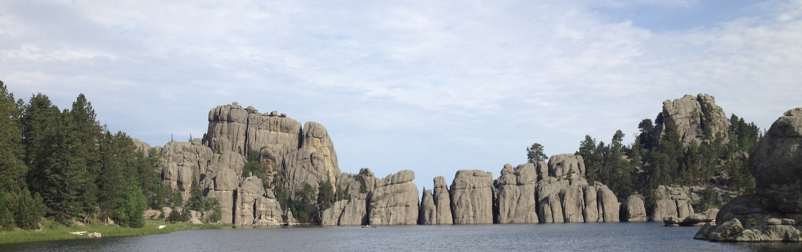
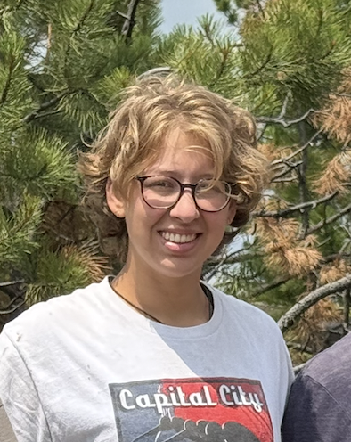

# Riley Cornella

  
  

    Hi! I am a master's student in the Department of Geology and Geophysics at the University of Wyoming.
      
    Advisor: Dr. Ken Sims
  

## Research
My research involves using machine learning to identify economically viable mineral deposits, and evaluating non-traditional stable isotopes to see whether they can be used to vector towards these deposits.
## Contact
rcornel7@uwyo.edu
## Additional Information
[Download my CV](CV.pdf)

[UW Geology and Geophysics](https://www.uwyo.edu/geolgeophys/)
